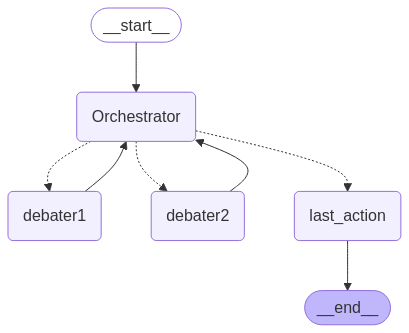

# Legal Exam Assistant: RAG, Question Generation and LLM Debate

Team project from a data challenge (spring 2025): a web application that helps candidates prepare for European patent law exams. It retrieves exam questions on a topic, generates new ones with a RAG pipeline when too few exist, and evaluates the user's answers with an LLM, either directly or through a multi-LLM debate.

Team: Dina Fettache, Madou Koné, Ahmad Fares (research interns at the Grenoble Informatics Laboratory, LIG). Presentation slides: [DataChallenge.pdf](DataChallenge.pdf).

## How it works

1. **Corpus**: past exam questions (EQE, EPAC) and official legal publications, converted from PDF to text and structured as JSON records (question, answer, explanation, legal basis). See [`datasets/`](datasets).
2. **Retrieval**: questions are embedded with `sentence-transformers/all-MiniLM-L6-v2` and indexed with **FAISS**. The user enters a topic and gets the most similar questions.
3. **Generation (RAG)**: if fewer than 10 relevant questions pass the similarity threshold, an LLM (Mistral, served locally with **Ollama**) generates the missing ones, using the retrieved questions and legal texts as few-shot context.
4. **Evaluation of the user's answer**, two modes:
   - **Direct**: the LLM compares the user's answer with the expected answer.
   - **Debate**: two LLMs (Mistral, Phi-4) debate under an orchestrator (Llama 3.3) for up to 5 turns, then a verdict is given. See [`rag/debate.py`](rag/debate.py).
5. **Carbon footprint**: inference runs are tracked with **CodeCarbon** ([`rag/emissions.csv`](rag/emissions.csv)).



## Repository structure

| Path | Role |
|------|------|
| `rag/rag.py` | FastAPI backend: `/search`, `/evaluate`, `/legal_query` endpoints, FAISS index, PDF export of results |
| `rag/db.py`, `rag/embeddings.py` | Embedding and indexing of the question corpus |
| `rag/debate.py`, `rag/run_debate.py` | Multi-LLM debate (orchestrator + 2 debaters) |
| `fine_tune/` | Exploratory fine-tuning of GPT-2 on the legal corpus |
| `readlib-front/` | Vue.js 3 + Vite + Tailwind frontend |
| `datasets/` | Exam questions (MCQ and open) and legal publications |

## Tech stack

Python · FastAPI · sentence-transformers · FAISS · Ollama (Mistral, Phi-4, Llama 3.3) · LangChain · CodeCarbon · Hugging Face Transformers · Vue.js · Tailwind CSS

## Run locally

```bash
# Backend
cd rag
pip install -r require.txt
ollama pull mistral        # plus phi4 and llama3.3 for the debate mode
./rag.py                   # FastAPI server

# Frontend
cd ../readlib-front
npm install
npm run dev
```

The frontend expects the API URL in a `readlib-front/.env` file: `VITE_API=http://127.0.0.1:8000`.
